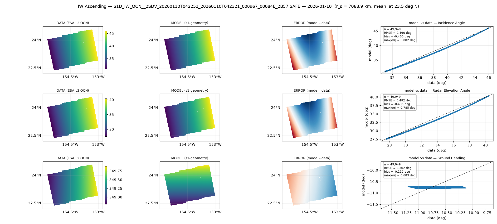
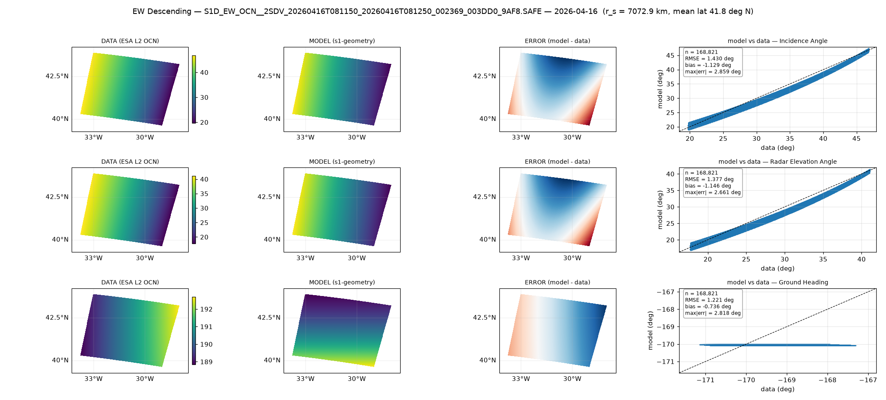
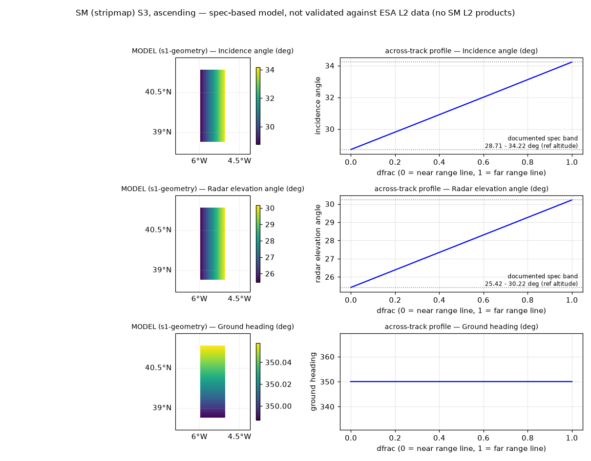
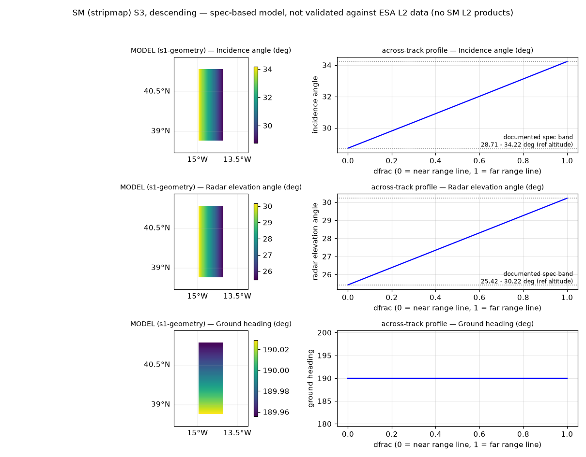

Certification against the ESA L2 OCN products
==============================================

This page documents the calibration of the angle estimators against the
ESA Sentinel-1 L2 OCN products (the ``owi`` grids of the ``S1D_{IW,EW,WV}
_OCN__2S`` products, which carry the per-pixel ``owiIncidenceAngle``,
``owiElevationAngle`` and ``owiHeading`` fields).

For each imaging mode two examples are shown — one **ascending** and one
**descending** acquisition.  For every example the library chain is
evaluated at every OCN grid cell and compared with the OCN fields:

* **IW / EW**: the SAFE footprint ring is inverted to the orbit distance
  ``r_s`` (swath width -> slant range), the off-nadir angle ``sigma`` is
  interpolated linearly across the swath between the near and far range
  lines, and the incidence angle is the ground angle
  ``asin((r_s / r_e) sin sigma)`` plus the deflection of the vertical; the
  radar elevation angle is the ESA OCN convention (off-nadir ``sigma``);
  the ground heading is the latitude polynomial of :mod:`s1_geometry.heading`.
* **WV**: the footprint is a MultiPolygon of burst rings; each OCN point is
  mapped to its burst ring, and the angles are computed from the burst
  geometry and the satellite distance taken from the OCN state vectors.
* **SM (stripmap)**: no SM L2 products exist in the CDSE archive, so the SM
  examples are **spec-based** (documented off-nadir bands per beam S1..S6,
  SentiWiki / ESA User Handbook) and are **not validated against ESA L2
  data**.  The SM ground swath is nearly altitude-invariant (~80 km for all
  beams and altitudes), so the orbit distance is pinned to the mid-band
  reference ``R_S_REF_SM_KM = 7082.7 km`` (intrinsic ~ +/-0.8 deg
  incidence uncertainty).

Each figure has one row per angle (incidence, radar elevation, ground
heading) and, for the IW / EW / WV examples, four columns: the ESA L2 OCN
data, the s1-geometry model, the error (model - data) and a model-vs-data
scatter plot with the number of points, the RMSE, the bias and the maximum
absolute error.

IW
--

Ascending: ``S1D_IW_OCN__2SDV_20260110T042252_20260110T042321_000967_00084E_2B57.SAFE``
(2026-01-10, ~23.5 N, r_s = 7068.9 km).

Descending: ``S1D_IW_OCN__2SDV_20260110T063235_20260110T063257_000968_000858_DB63.SAFE``
(2026-01-10, ~44.9 N, r_s = 7072.9 km).

.. image:: _static/certification/iw_desc.png
   :align: center
   :width: 100%

EW
--

Ascending: ``S1D_EW_OCN__2SDV_20261106T191651_20261106T191758_005351_00A31E_D0E6.SAFE``
(2026-11-06, ~43.2 N, r_s = 7072.6 km).

.. image:: _static/certification/ew_asc.png
   :align: center
   :width: 100%

Descending: ``S1D_EW_OCN__2SDV_20260416T081150_20260416T081250_002369_003DD0_9AF8.SAFE``
(2026-04-16, ~41.8 N, r_s = 7072.9 km).

The EW model carries a systematic bias of about -1.1 deg on the incidence
angle: the across-track sigma is interpolated linearly between the near and
far range lines while the five EW subswaths (EW1..EW5) are acquired with
five discrete beams.  The per-subswath RMSE is 0.8-1.9 deg; the bias is a
model-behaviour, not a bug.

WV
--

Ascending: ``S1D_WV_OCN__2SSV_20260828T233712_20260828T234055_004332_007FE6_03DE.SAFE``
(2026-08-28, mean lat ~22.5 S, 16 bursts, r_s from the OCN state vectors).

.. image:: _static/certification/wv_asc.png
   :align: center
   :width: 100%

Descending: ``S1D_WV_OCN__2SSV_20260826T015607_20260826T020019_004290_007E63_62F7.SAFE``
(2026-08-26, mean lat ~33.2 S, 18 bursts, r_s from the OCN state vectors).

.. image:: _static/certification/wv_desc.png
   :align: center
   :width: 100%

SM (stripmap)
-------------

No SM L2 products exist in the CDSE archive (v1 and v2, 2014-2026), so the
SM examples are **spec-based**: a synthetic SM S3 SAFE ring (300 km burst,
40 N) is built from the documented off-nadir band of the S3 beam and the
constant-slant-range model, and the model angles are shown over the ring
with the across-track profiles against the documented spec bands.  These
examples are **not validated against ESA L2 data**.

Ascending:

Descending:

Summary of the statistics
-------------------------

The per-example statistics (n, RMSE, bias, and the maximum absolute
error, in degrees, model minus data) are written to
``docs/_static/certification/stats.json`` by the figure generation script.

IW
^^^

+-----------+-----------+----------+---------+---------+----------+
| orbit     | angle     | n        | RMSE    | bias    | max|err| |
+===========+===========+==========+=========+=========+==========+
| ascending | incidence | 49,949   | 0.466   | -0.400  | 0.802    |
+-----------+-----------+----------+---------+---------+----------+
| ascending | elevation | 49,949   | 0.482   | -0.436  | 0.785    |
+-----------+-----------+----------+---------+---------+----------+
| ascending | heading   | 49,949   | 0.302   | -0.112  | 0.683    |
+-----------+-----------+----------+---------+---------+----------+
| descending| incidence | 36,830   | 0.482   | -0.365  | 0.982    |
+-----------+-----------+----------+---------+---------+----------+
| descending| elevation | 36,830   | 0.559   | -0.490  | 1.019    |
+-----------+-----------+----------+---------+---------+----------+
| descending| heading   | 36,830   | 0.665   | -0.146  | 1.399    |
+-----------+-----------+----------+---------+---------+----------+

EW
^^^

+-----------+-----------+-----------+---------+---------+----------+
| orbit     | angle     | n         | RMSE    | bias    | max|err| |
+===========+===========+===========+=========+=========+==========+
| ascending | incidence | 188,580   | 1.375   | -0.988  | 2.916    |
+-----------+-----------+-----------+---------+---------+----------+
| ascending | elevation | 188,580   | 1.319   | -1.025  | 2.711    |
+-----------+-----------+-----------+---------+---------+----------+
| ascending | heading   | 188,580   | 1.297   | +0.790  | 3.015    |
+-----------+-----------+-----------+---------+---------+----------+
| descending| incidence | 168,821   | 1.430   | -1.129  | 2.859    |
+-----------+-----------+-----------+---------+---------+----------+
| descending| elevation | 168,821   | 1.377   | -1.146  | 2.661    |
+-----------+-----------+-----------+---------+---------+----------+
| descending| heading   | 168,821   | 1.221   | -0.736  | 2.818    |
+-----------+-----------+-----------+---------+---------+----------+

WV
^^^

+-----------+-----------+--------+---------+---------+----------+
| orbit     | angle     | n      | RMSE    | bias    | max|err| |
+===========+===========+========+=========+=========+==========+
| ascending | incidence | 6,400  | 0.287   | -0.269  | 0.443    |
+-----------+-----------+--------+---------+---------+----------+
| ascending | elevation | 6,400  | 0.269   | -0.252  | 0.415    |
+-----------+-----------+--------+---------+---------+----------+
| ascending | heading   | 6,400  | 0.090   | +0.089  | 0.107    |
+-----------+-----------+--------+---------+---------+----------+
| descending| incidence | 7,200  | 0.192   | -0.154  | 0.342    |
+-----------+-----------+--------+---------+---------+----------+
| descending| elevation | 7,200  | 0.175   | -0.137  | 0.312    |
+-----------+-----------+--------+---------+---------+----------+
| descending| heading   | 7,200  | 0.091   | -0.089  | 0.111    |
+-----------+-----------+--------+---------+---------+----------+

Sentinel-1A / -1C / -1D statistical validation (metadata only)
^^^^^^^^^^^^^^^^^^^^^^^^^^^^^^^^^^^^^^^^^^^^^^^^^^^^^^^^^^^^^^^

``scripts/validate_wv_ocn.py`` runs the metadata-only chain -- the product
footprint (the ``manifest.safe`` imagette rings, identical to the CDSE OData
``Footprint``), ``r_s`` from the orbit model of :mod:`s1_geometry.orbit`,
``window="auto"`` -- on every ``owi`` cell of every imagette (the ``osw``
imagette centre for the products before mid-2020, whose WV ``owi`` grid is
empty).  Sample: one day per month (three products per day spread over the
day) for S1C (2025-2026) and S1D (2026), S1A 2025-2026 plus one day per year
2015-2024; 164 products, latitudes -80 to +52 deg, up to 143 imagettes,
2,974,963 cells.  Per product statistics:
``_static/certification/wv_validation_s1acd.csv``.

Look-angle law recalibration.  The first law (a linear latitude term fitted
on 64 mostly southern-hemisphere products) had an incidence bias growing in
the northern hemisphere (+0.6 deg at 30 N, +0.9 deg at 45-50 N).  The latitude
term is now a degree-5 polynomial, fitted by
``scripts/calibrate_wv_look_angle.py`` (one Newton step per imagette on the
incidence error) on 62,588 imagettes of 1,205 S1C / S1D products of *other*
days than the validation sample (latitudes -79.5 to +86 deg); S1A is not used
in the fit.

+-----------+-----------+--------------+-------------+--------------+------------+
| satellite | products  | incidence    | elevation   | heading      | inc. max   |
|           |           | RMSE (deg)   | RMSE (deg)  | RMSE (deg)   | abs. error |
+===========+===========+==============+=============+==============+============+
| S1A       | 75        | 0.021        | 0.033       | 0.097        | 0.159      |
+-----------+-----------+--------------+-------------+--------------+------------+
| S1C       | 57        | 0.019        | 0.032       | 0.096        | 0.163      |
+-----------+-----------+--------------+-------------+--------------+------------+
| S1D       | 32        | 0.069        | 0.065       | 0.123        | 0.475      |
+-----------+-----------+--------------+-------------+--------------+------------+
| all       | 164       | 0.036        | 0.041       | 0.103        | 0.475      |
+-----------+-----------+--------------+-------------+--------------+------------+
| first law | 163       | 0.233        | 0.224       | 0.098        | 1.634      |
+-----------+-----------+--------------+-------------+--------------+------------+

Subswath (WV1 / WV2) labels are 100 % correct and no cell falls outside the
footprint.  The incidence bias is below 0.08 deg in every latitude band.  The
heading p95 error of the worst product is 0.36 deg (S1D products through the
polar turn), hence the WV heading uncertainty of 0.4 deg.  Long products need
the sliding-window track fit (``window="auto"``): with a single track geometry
their heading RMSE is 0.36 instead of 0.09 deg.

Excluded from the statistics:

* the S1C commissioning phase (before 2025-03-08, no S1C POEORB, orbit not
  yet the reference one);
* end-of-datatake products with 2 imagettes (at least 4 are needed);
* reference headings known to be wrong: ``owiHeading`` of the IPF 003.31
  products (2021: 357 deg on a descending pass), imagettes whose
  ``owiHeading`` is constant at 90.0004 deg (an ESA default value, seen near
  the antimeridian), and ``oswHeading`` (before mid-2020; a different
  quantity, 1-6 deg away from the ground-track heading).

The centre of an imagette ring is the mean of its *closed* ring vertices (the
first vertex counted twice), the convention of the CDSE footprints the
look-angle law is calibrated with.

Orbit model stability
^^^^^^^^^^^^^^^^^^^^^

All Sentinel-1 units fly the same reference orbit, only phased differently,
so ``r_s(lat, pass)`` does not depend on the unit or on its slot.  Checked
on POEORB files from 2025-01 to 2026-10 (S1A, S1C, S1D monthly, S1C every 3
days from April to July 2026 around its move to the former S1A slot;
``_static/certification/orbit_r_s_drift_2025_2026.csv``): bias within
0.03 km and residual std 0.10-0.11 km on every day, except the S1C
commissioning (2025-03-15, -1.9 km) and 2026-06-21 (+1.9 km), during the S1C
relocation when S1C acquired nothing (no product from 2026-06-09 to
2026-06-23).  1 km of ``r_s`` error is ~0.06 deg of incidence.

SM
^^^

Spec-based only (no SM L2 products in the CDSE archive): the across-track
profiles of the synthetic S3 examples reproduce the documented off-nadir
bands of the S3 beam (24.67-29.45 deg at the reference altitude) and the
incidence range (28.7-34.2 deg at 40 N).  Not validated against ESA L2
data.
