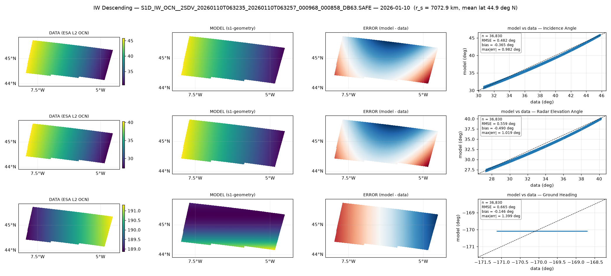
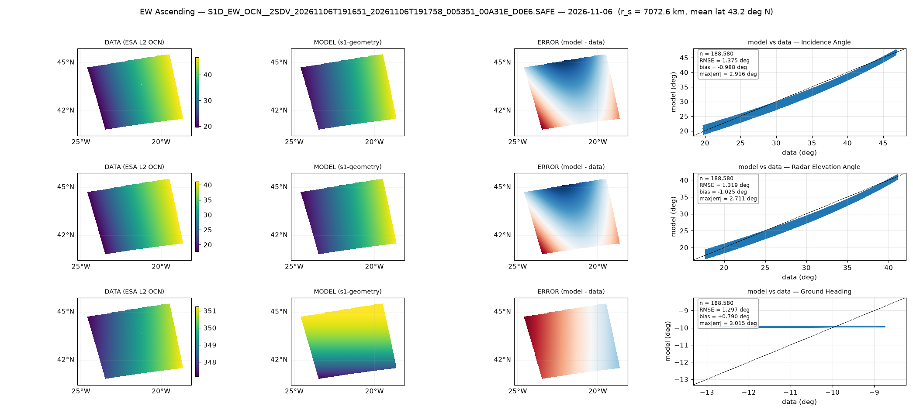
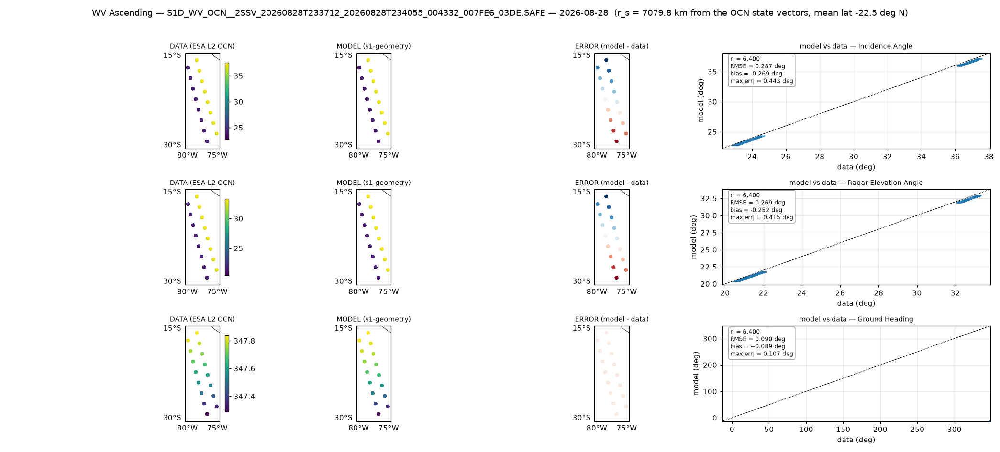
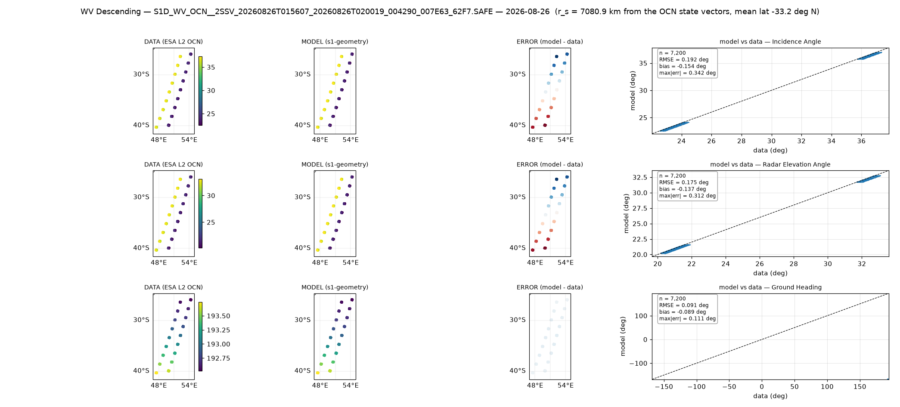

Certification against the ESA L2 OCN products
==============================================

This page documents the calibration of the angle estimators against the
ESA Sentinel-1 L2 OCN products (the ``owi`` grids of the ``S1D_{IW,EW,WV}
_OCN__2S`` products, which carry the per-pixel ``owiIncidenceAngle``,
``owiElevationAngle`` and ``owiHeading`` fields).

For each imaging mode two examples are shown — one **ascending** and one
**descending** acquisition.  For every example the library chain is
evaluated at every OCN grid cell and compared with the OCN fields:

* **IW / EW**: the SAFE footprint ring is inverted to the orbit distance
  ``r_s`` (swath width -> slant range), the off-nadir angle ``sigma`` is
  interpolated linearly across the swath between the near and far range
  lines, and the incidence angle is the ground angle
  ``asin((r_s / r_e) sin sigma)`` plus the deflection of the vertical; the
  radar elevation angle is the ESA OCN convention (off-nadir ``sigma``);
  the ground heading is the latitude polynomial of :mod:`s1_geometry.heading`.
* **WV**: the footprint is a MultiPolygon of burst rings; each OCN point is
  mapped to its burst ring, and the angles are computed from the burst
  geometry and the satellite distance taken from the OCN state vectors.
* **SM (stripmap)**: no SM L2 products exist in the CDSE archive, so the SM
  examples are **spec-based** (documented off-nadir bands per beam S1..S6,
  SentiWiki / ESA User Handbook) and are **not validated against ESA L2
  data**.  The SM ground swath is nearly altitude-invariant (~80 km for all
  beams and altitudes), so the orbit distance is pinned to the mid-band
  reference ``R_S_REF_SM_KM = 7082.7 km`` (intrinsic ~ +/-0.8 deg
  incidence uncertainty).

Each figure has one row per angle (incidence, radar elevation, ground
heading) and, for the IW / EW / WV examples, four columns: the ESA L2 OCN
data, the s1-geometry model, the error (model - data) and a model-vs-data
scatter plot with the number of points, the RMSE, the bias and the maximum
absolute error.

IW
--

Ascending: ``S1D_IW_OCN__2SDV_20260110T042252_20260110T042321_000967_00084E_2B57.SAFE``
(2026-01-10, ~23.5 N, r_s = 7068.9 km).

.. image:: _static/certification/iw_asc.png
   :align: center
   :width: 100%

Descending: ``S1D_IW_OCN__2SDV_20260110T063235_20260110T063257_000968_000858_DB63.SAFE``
(2026-01-10, ~44.9 N, r_s = 7072.9 km).

EW
--

Ascending: ``S1D_EW_OCN__2SDV_20261106T191651_20261106T191758_005351_00A31E_D0E6.SAFE``
(2026-11-06, ~43.2 N, r_s = 7072.6 km).

Descending: ``S1D_EW_OCN__2SDV_20260416T081150_20260416T081250_002369_003DD0_9AF8.SAFE``
(2026-04-16, ~41.8 N, r_s = 7072.9 km).

.. image:: _static/certification/ew_desc.png
   :align: center
   :width: 100%

The EW model carries a systematic bias of about -1.1 deg on the incidence
angle: the across-track sigma is interpolated linearly between the near and
far range lines while the five EW subswaths (EW1..EW5) are acquired with
five discrete beams.  The per-subswath RMSE is 0.8-1.9 deg; the bias is a
model-behaviour, not a bug.

WV
--

Ascending: ``S1D_WV_OCN__2SSV_20260828T233712_20260828T234055_004332_007FE6_03DE.SAFE``
(2026-08-28, mean lat ~22.5 S, 16 bursts, r_s from the OCN state vectors).

Descending: ``S1D_WV_OCN__2SSV_20260826T015607_20260826T020019_004290_007E63_62F7.SAFE``
(2026-08-26, mean lat ~33.2 S, 18 bursts, r_s from the OCN state vectors).

SM (stripmap)
-------------

No SM L2 products exist in the CDSE archive (v1 and v2, 2014-2026), so the
SM examples are **spec-based**: a synthetic SM S3 SAFE ring (300 km burst,
40 N) is built from the documented off-nadir band of the S3 beam and the
constant-slant-range model, and the model angles are shown over the ring
with the across-track profiles against the documented spec bands.  These
examples are **not validated against ESA L2 data**.

Ascending:

.. image:: _static/certification/sm_asc.png
   :align: center
   :width: 80%

Descending:

.. image:: _static/certification/sm_desc.png
   :align: center
   :width: 80%

Summary of the statistics
-------------------------

The per-example statistics (n, RMSE, bias, and the maximum absolute
error, in degrees, model minus data) are written to
``docs/_static/certification/stats.json`` by the figure generation script.

IW
^^^

+-----------+-----------+----------+---------+---------+----------+
| orbit     | angle     | n        | RMSE    | bias    | max|err| |
+===========+===========+==========+=========+=========+==========+
| ascending | incidence | 49,949   | 0.466   | -0.400  | 0.802    |
+-----------+-----------+----------+---------+---------+----------+
| ascending | elevation | 49,949   | 0.482   | -0.436  | 0.785    |
+-----------+-----------+----------+---------+---------+----------+
| ascending | heading   | 49,949   | 0.302   | -0.112  | 0.683    |
+-----------+-----------+----------+---------+---------+----------+
| descending| incidence | 36,830   | 0.482   | -0.365  | 0.982    |
+-----------+-----------+----------+---------+---------+----------+
| descending| elevation | 36,830   | 0.559   | -0.490  | 1.019    |
+-----------+-----------+----------+---------+---------+----------+
| descending| heading   | 36,830   | 0.665   | -0.146  | 1.399    |
+-----------+-----------+----------+---------+---------+----------+

EW
^^^

+-----------+-----------+-----------+---------+---------+----------+
| orbit     | angle     | n         | RMSE    | bias    | max|err| |
+===========+===========+===========+=========+=========+==========+
| ascending | incidence | 188,580   | 1.375   | -0.988  | 2.916    |
+-----------+-----------+-----------+---------+---------+----------+
| ascending | elevation | 188,580   | 1.319   | -1.025  | 2.711    |
+-----------+-----------+-----------+---------+---------+----------+
| ascending | heading   | 188,580   | 1.297   | +0.790  | 3.015    |
+-----------+-----------+-----------+---------+---------+----------+
| descending| incidence | 168,821   | 1.430   | -1.129  | 2.859    |
+-----------+-----------+-----------+---------+---------+----------+
| descending| elevation | 168,821   | 1.377   | -1.146  | 2.661    |
+-----------+-----------+-----------+---------+---------+----------+
| descending| heading   | 168,821   | 1.221   | -0.736  | 2.818    |
+-----------+-----------+-----------+---------+---------+----------+

WV
^^^

+-----------+-----------+--------+---------+---------+----------+
| orbit     | angle     | n      | RMSE    | bias    | max|err| |
+===========+===========+========+=========+=========+==========+
| ascending | incidence | 6,400  | 0.287   | -0.269  | 0.443    |
+-----------+-----------+--------+---------+---------+----------+
| ascending | elevation | 6,400  | 0.269   | -0.252  | 0.415    |
+-----------+-----------+--------+---------+---------+----------+
| ascending | heading   | 6,400  | 0.090   | +0.089  | 0.107    |
+-----------+-----------+--------+---------+---------+----------+
| descending| incidence | 7,200  | 0.192   | -0.154  | 0.342    |
+-----------+-----------+--------+---------+---------+----------+
| descending| elevation | 7,200  | 0.175   | -0.137  | 0.312    |
+-----------+-----------+--------+---------+---------+----------+
| descending| heading   | 7,200  | 0.091   | -0.089  | 0.111    |
+-----------+-----------+--------+---------+---------+----------+

Sentinel-1C statistical validation (metadata only)
^^^^^^^^^^^^^^^^^^^^^^^^^^^^^^^^^^^^^^^^^^^^^^^^^^

``scripts/validate_wv_ocn.py`` runs the metadata-only chain -- the product
footprint (the ``manifest.safe`` imagette rings, identical to the CDSE OData
``Footprint``) and ``r_s`` from the orbit model of :mod:`s1_geometry.orbit`,
``window="auto"`` -- on every ``owi`` cell of 63 S1C WV OCN products (one day
per month from 2025-01-17 to 2026-11-12, three products per day spread over
the day; 27 ascending, 36 descending; latitudes -73.9 to +51.7 deg; 45
products longer than 40 imagettes, up to 118 imagettes / 28.6 min).  Per
product statistics: ``_static/certification/wv_s1c_validation.csv``.

+-----------+---------+---------+------------------+-------------+
| angle     | RMSE    | bias    | p95 (worst prod.)| max|err|    |
+===========+=========+=========+==================+=============+
| incidence | 0.243   | -0.103  | 1.168            | 1.308       |
+-----------+---------+---------+------------------+-------------+
| elevation | 0.232   | -0.094  | 1.050            | 1.178       |
+-----------+---------+---------+------------------+-------------+
| heading   | 0.094   | -0.015  | 0.234            | 0.260       |
+-----------+---------+---------+------------------+-------------+

1,427,863 cells, none outside the footprint, subswath (WV1 / WV2) labels
100 % correct.  Products of more than 40 imagettes need the sliding-window
track fit: their median incidence RMSE is 0.22 deg with it and 0.45 deg with
a single track geometry (heading 0.09 vs 0.36 deg).  The worst product
(2025-01-17, incidence bias +0.94 deg) was acquired during the S1C
commissioning phase, before the operational orbit (no S1C POEORB exists
before 2025-03-08); without the commissioning products: 57 products,
incidence RMSE 0.235 deg.  Six end-of-datatake products with only 2
imagettes were skipped (at least 4 are needed).

The centre of an imagette ring is the mean of its *closed* ring vertices (the
first vertex counted twice), the convention of the footprints the look-angle
law was calibrated with: the plain vertex mean gives an incidence RMSE of
0.33 deg instead of 0.24 deg.

SM
^^^

Spec-based only (no SM L2 products in the CDSE archive): the across-track
profiles of the synthetic S3 examples reproduce the documented off-nadir
bands of the S3 beam (24.67-29.45 deg at the reference altitude) and the
incidence range (28.7-34.2 deg at 40 N).  Not validated against ESA L2
data.
