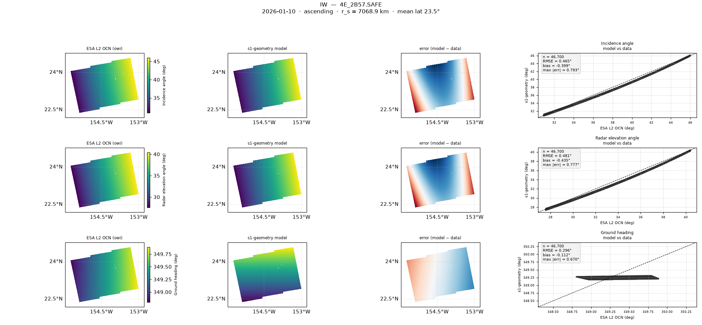
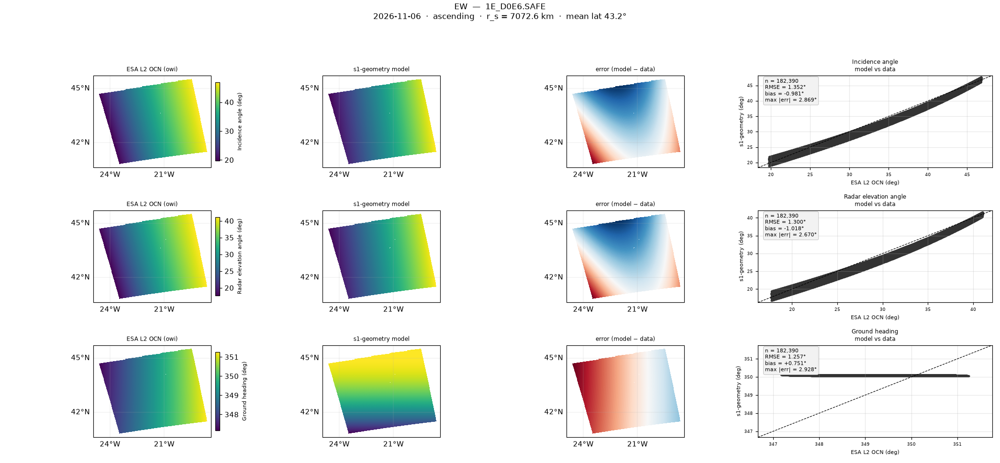
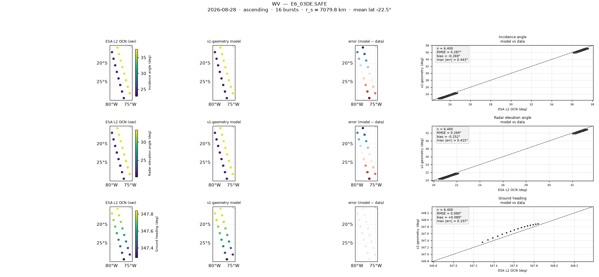
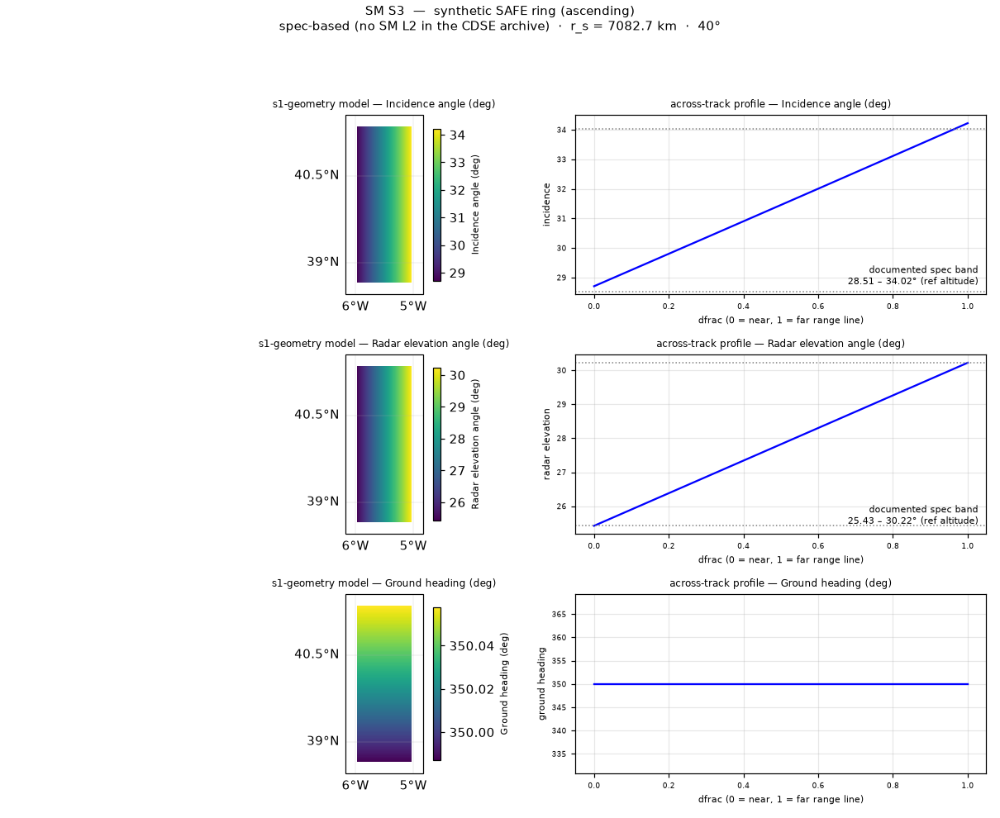
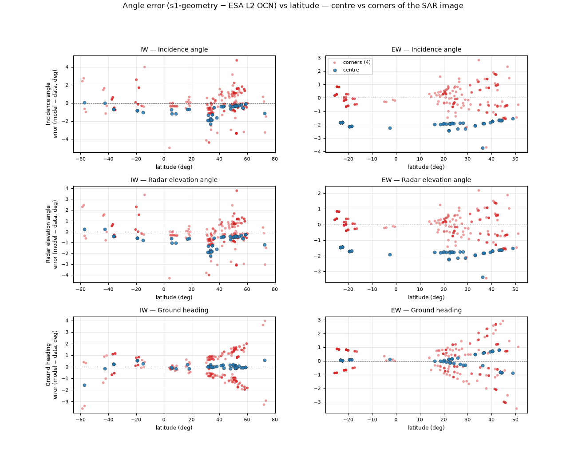

Worked examples
===============

This page shows, for each Sentinel-1 imaging mode, the ESA L2 OCN (``owi``)
angle fields of a real acquisition next to the s1-geometry estimates
evaluated at every OCN grid cell, together with the error (model − data)
and a model-vs-data scatter plot with the RMSE, the bias and the maximum
absolute error.  A final figure shows how the angle error varies with
latitude, for the centre and the four corners of the SAR image, over many
acquisitions.

The full validation (one ascending and one descending example per mode,
with the per-example statistics tables) is on the :doc:`certification`
page.

IW (interferometric wide swath)
-------------------------------

``S1D_IW_OCN__2SDV_20260110T042252_20260110T042321_000967_00084E_2B57.SAFE``
(2026-01-10, ascending, ~23.5 N, r_s = 7068.9 km; RMSE inc / el / heading
= 0.47 / 0.48 / 0.30 deg over 46 700 OCN cells).

EW (extra-wide swath)
---------------------

``S1D_EW_OCN__2SDV_20261106T191651_20261106T191758_005351_00A31E_D0E6.SAFE``
(2026-11-06, ascending, ~43.2 N, r_s = 7072.6 km; RMSE inc / el / heading
= 1.35 / 1.30 / 1.26 deg over 47 800 OCN cells).

The EW model carries a systematic bias of about −1.0 deg on the incidence
angle: the across-track sigma is interpolated linearly between the near
and far range lines, while the five EW subswaths (EW1..EW5) are acquired
with five discrete beams.  The per-subswath RMSE is 0.8–1.9 deg; the bias
is a model behaviour, not a bug.

WV (Wave mode)
--------------

``S1D_WV_OCN__2SSV_20260828T233712_20260828T234055_004332_007FE6_03DE.SAFE``
(2026-08-28, ascending, 16 bursts, r_s = 7079.8 km from the OCN state
vectors; RMSE inc / el / heading = 0.29 / 0.27 / 0.09 deg over 6 400 OCN
cells).

SM (stripmap)
-------------

No SM L2 products exist in the CDSE archive, so the SM example is
**spec-based**: the canonical S3 SAFE ring used in the test suite (300 km
burst, 40 N, ascending) is evaluated with the spec-based SM chain (the
across-track sigma is interpolated between the documented near / far
off-nadir bands of the S3 beam at the reference distance).  The right
column shows the across-track profiles against the documented spec bands
(dotted lines).  This example is **not validated against ESA L2 data**.

Error vs latitude — centre vs corners
-------------------------------------

For 60 acquisitions per mode (the first non-excluded product of every
other day of 2026), the angle error (model − data) is evaluated at the
centre of the SAFE footprint (blue) and at its four corners (red), and
plotted against latitude.  The centre is consistently tighter than the
corners, as expected: the across-track sigma is anchored on the range
lines, so the interpolation is exact at the swath centre (dfrac = 1/2) and
degrades towards the near / far edges.

.. note::

   A small number of acquisitions are excluded, for three independent
   reasons:

   * **Ambiguous orbit direction.**  For near-square footprints (the two
     opposite edge families of the SAFE ring have nearly the same length)
     the ring-only orbit-direction rule of
     :func:`s1_geometry.orbit_direction_from_ring` can pick the wrong pass
     direction, which flips the heading error by ~180 deg and mirrors the
     across-track incidence / elevation.  Products whose ring-derived orbit
     direction disagrees with the measured OWI heading are left out.
   * **Partial-swath OCN products.**  Some OCN products carry a full-swath
     ``GeoFootprint`` ring but image only part of the swath, so the
     across-track (range-line) span of the valid OWI cells is well below the
     full swath.  Evaluating the model at a corner that falls outside the
     imaged region returns a spurious bias (up to ~11 deg).  Products whose
     OWI cells do not span the full swath are left out.
   * **Ambiguous range lines.**  For footprints whose SAFE ring is not a
     clean parallelogram (near-square, or with curved range lines) the
     across-track range-line identification can pick the wrong axis, giving
     a spurious near/far mirror at the corners (up to ~27 deg).  Products
     whose model-vs-data incidence error exceeds 5 deg at a corner are left
     out.

