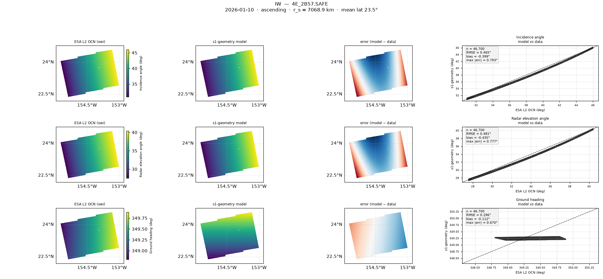

s1-geometry
===========

Library to estimate geometric quantities (ground heading, incidence and
radar elevation angles) from a Sentinel-1 SAR footprint (the SAFE polygon,
e.g. the CDSE ``GeoFootprint`` column).

The library provides:

* the **IW / EW / SM incidence and elevation angles** of an acquisition at a
  reference point (the SM beams S1..S6 are supported, spec-based, not
  validated against ESA L2 data);
* the **WV (Wave mode) per-point angles** -- incidence, elevation and
  heading -- from the product footprint (a MultiPolygon of imagette rings)
  alone: the satellite distance comes from a metadata-only orbit model, so the
  CDSE OData metadata (``Footprint``) is enough, no orbit file or SAR data;
* the **IW ground heading** as a function of the reference point and the SAFE
  footprint polygon, together with a latitude-dependent uncertainty.

::

   from s1_geometry import estimate_geometry, estimate_incidence_elevation

   geometry = estimate_geometry(footprint_polygon, ref_lat=36.592652)
   print(geometry.heading_deg, geometry.heading_uncertainty_deg)

   angles = estimate_incidence_elevation(footprint_polygon, 10.5, 36.59, "IW")
   print(angles.incidence_deg, angles.elevation_deg)

.. code-block:: bash

   s1-geometry heading footprint.geojson --lat 36.59
   s1-geometry angles footprint.geojson --lon 10.5 --lat 36.59 --mode IW
   s1-geometry angles footprint.geojson --lon 10.5 --lat 36.59 --mode SM --beam S3
   s1-geometry wv "<OData Footprint WKT>" --lon -76.7 --lat -29.3

The heading model is a per-orbit-direction degree-4 polynomial in latitude,
fitted on 11107 IW OCN products; 98.88 % of the measured headings fall within
the returned uncertainty. See :doc:`usage` and :doc:`certification` for the
validation against the ESA L2 OCN products.

Test suite: ``python -m pytest -q``.

        and model-vs-data scatter

One IW example: the ESA L2 OCN (``owi``) angle fields, the s1-geometry
estimates and the error, one row per angle.  See :doc:`figures` for one
example per mode (IW, EW, WV, SM) and the error vs latitude for the
centre and corners of the SAR image.

.. toctree::
   :maxdepth: 2

   usage
   figures
   certification
   api/s1_geometry
