How it works
============

This page explains, in plain words, what s1-geometry needs as input, how it
turns that input into angles, and how each model was calibrated and checked.
It is a short *Algorithm Theoretical Basis Document* (ATBD).

.. contents:: On this page
   :local:
   :depth: 1

The idea in one paragraph
-------------------------

A SAR image only exists because a satellite, at a known height, looked
sideways at a known angle.  The **footprint** of the image -- the polygon
published in the Copernicus catalogue -- therefore carries geometry: its
position, its orientation and its width.  s1-geometry reads that geometry
back and, with a few models of how Sentinel-1 flies and points its antenna,
recovers the **incidence angle**, the **radar elevation angle** and the
**ground heading** at any point of the image.  No SAR pixel, no orbit file and
no elevation model are needed: the catalogue metadata are enough.

Inputs and outputs
------------------

.. list-table::
   :header-rows: 1
   :widths: 28 72

   * - Input
     - Where it comes from
   * - Footprint polygon
     - The CDSE catalogue: OData ``Footprint`` (WKT) or ``GeoFootprint``
       (GeoJSON), also in the daily Parquet files.  4 corners for IW / EW / SM;
       one small polygon per imagette, in time order, for WV.
   * - Reference point
     - Any (longitude, latitude) inside the footprint, e.g. the image centre,
       a buoy, an altimeter crossing.
   * - Imaging mode
     - The product name or the ``operationalMode`` attribute (IW, EW, SM, WV).
   * - Pass direction (optional)
     - The ``orbitDirection`` attribute.  The library can derive it from the
       footprint itself.

.. list-table::
   :header-rows: 1
   :widths: 28 72

   * - Output
     - Meaning
   * - Incidence angle θ
     - Angle between the radar line of sight and the local vertical at the
       point (degrees).
   * - Radar elevation angle σ
     - Angle at the satellite between the nadir direction and the line of
       sight, also called the *off-nadir* angle.  This is the ESA L2 OCN
       ``owiElevationAngle`` convention -- it is **not** ``90° − θ``.
   * - Ground heading
     - Direction of the satellite ground track at the point, in degrees
       clockwise from North (about 350° for an ascending pass, 190° for a
       descending one at low latitude).

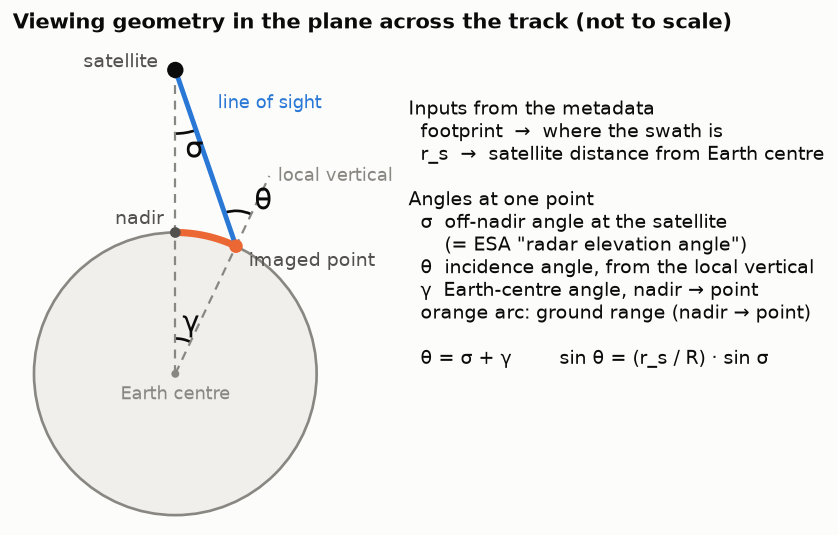

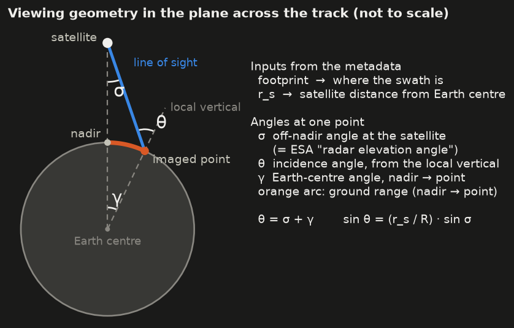

All the angle models use the same triangle: the satellite, the Earth centre
and the imaged point.  Knowing the satellite distance from the Earth centre
(``r_s``) and **one** angle fixes the triangle: the off-nadir angle σ gives
the incidence through ``sin θ = (r_s / R) sin σ`` (``R`` is the Earth radius
at the point), and ``θ = σ + γ``.  The work of the library is therefore to
find ``r_s`` and σ for each point.  Sentinel-1 always looks to the **right**
of its flight direction.

Pass direction from the footprint
---------------------------------

The flight runs along the short sides of an IW footprint (one burst is
150-180 km long, the swath is about 250 km wide), along the long sides of an
SM footprint (the SM swath is about 80 km wide) and is decided from the two
possible swath widths for the square-ish EW footprints.  Because the radar
looks right, the near-range side of the footprint is on the flight's right,
which fixes the sign: the pass is *ascending* if the flight goes north,
*descending* if it goes south, and *turning* at the polar turn.  This rule
reproduces the catalogue ``orbitDirection`` for 99.7 % of IW and 92 % of EW
footprints (66,243 footprints, 2026-11-01 to 13).  Footprints smaller than a
swath (e.g. one WV imagette) are rejected.

IW, EW and SM: angles from the 4-corner footprint
-------------------------------------------------

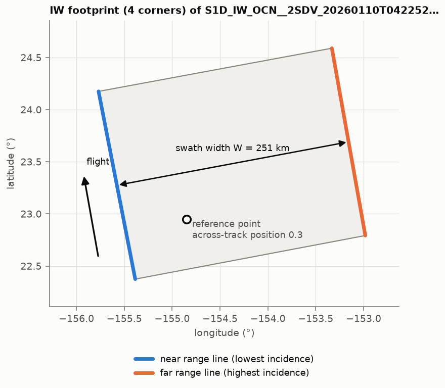

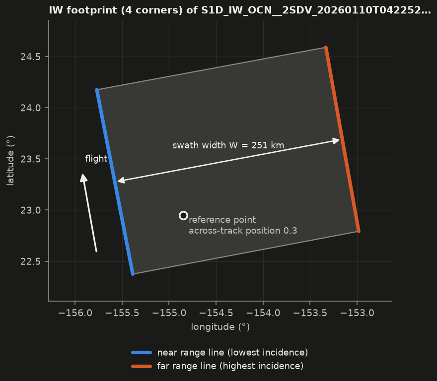

1. **Find the near and far range lines.**  These are the two footprint edges
   parallel to the flight; the near one is the closest to the ground track.
2. **Measure the swath width W** between the middles of the two range lines.
3. **Satellite distance from the width.**  The catalogue footprint is drawn
   for fixed near and far slant ranges (the radar time window) on a 6,371 km
   sphere.  For such a footprint the width only depends on how far the
   satellite is, so W can be inverted to a distance ``r_s``.  This is a
   *footprint-equivalent* distance: it is within about ±9 km of the true
   satellite distance (enough for the angles, which change by ~0.06° per km).
4. **Off-nadir angle at the point.**  ESA documents the off-nadir angle of
   the near edge (IW1 / EW1) and of the far edge (IW3 / EW5) of the swath at
   the lowest and highest orbit altitudes.  The library interpolates those
   values to the satellite distance, then linearly across the swath at the
   position of the point (0 at the near line, 1 at the far line).
5. **Incidence and elevation.**  The incidence follows from the triangle
   above, using the WGS84 radius at the point and a small correction for the
   difference between the geocentric and geodetic vertical (at most 0.19°).
   The elevation is the off-nadir angle itself.
6. **Heading.**  The IW heading model below (used as an approximation for EW
   and SM).

**SM (stripmap)** uses the same chain with the documented off-nadir band of
the chosen beam (S1 to S6).  Its swath is about 80 km wide whatever the
altitude, so the width cannot give the satellite distance: a mean value
(7,082.7 km) is used, which costs up to about ±0.8° of incidence.  No SM L2
product exists in the archive, so SM is **specification-based and not
validated**.

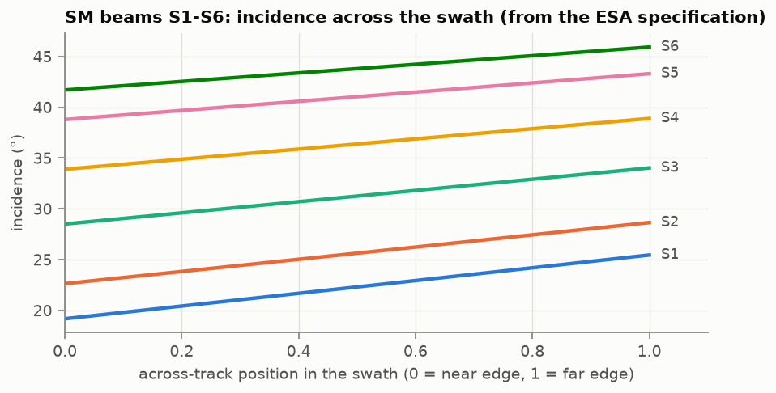

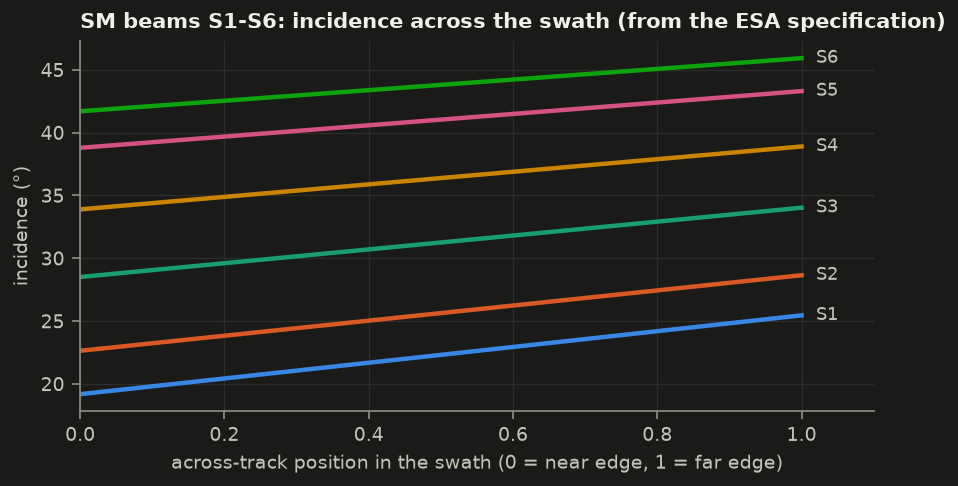

IW heading model
----------------

The ground heading of a Sentinel-1 pass depends almost only on the latitude
and on the pass direction, and all the units fly the same orbit.  Two
polynomials of degree 4 in latitude (one per pass direction) are therefore
enough.  They were fitted on the measured heading of 11,107 IW OCN products
(13 consecutive days, all the units in orbit), for latitudes up to 70°.  The
returned **uncertainty** U is the 95th percentile of the fit error in 1°
latitude bins, separately for each hemisphere; it grows fast beyond 70°,
where the polynomials extrapolate, so that users can decide themselves.
98.9 % of the measured headings fall within ±U.

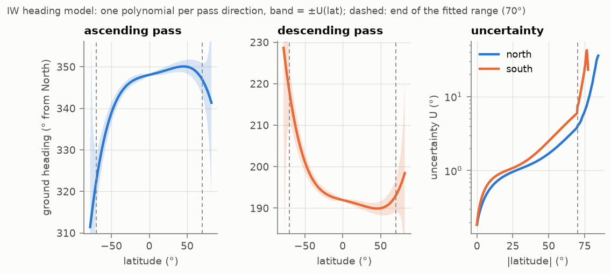

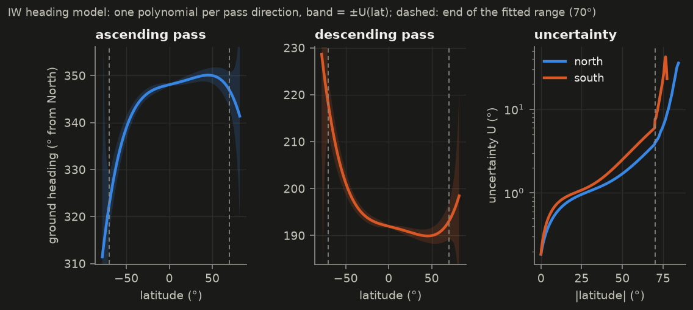

WV: angles from the imagette chains
-----------------------------------

In Wave mode the radar takes a ~20 km imagette every ~100 km, alternating
between two fixed beams: **WV1** (near, ~23° incidence) and **WV2** (far,
~36°).  The product footprint is the list of those imagettes in time order.

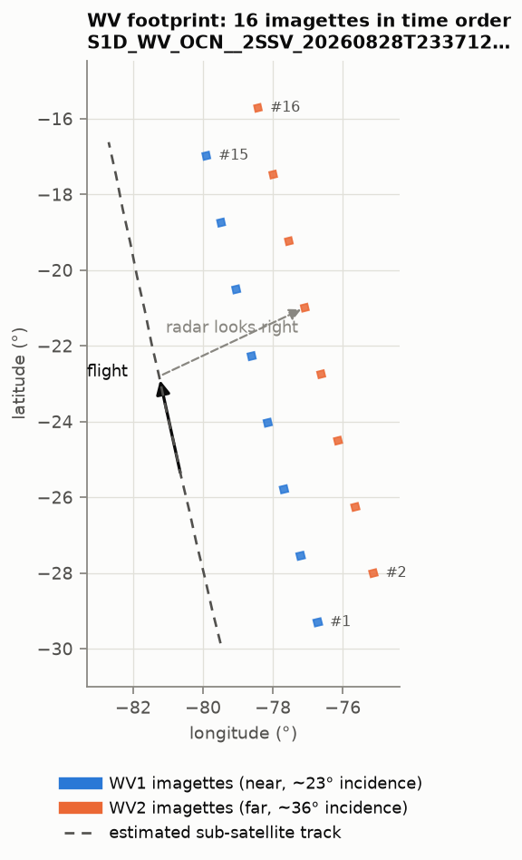

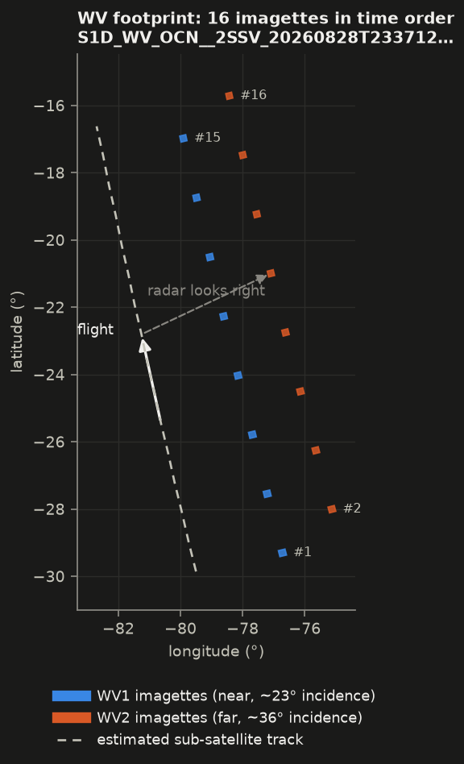

1. **Re-join and check the imagettes.**  An imagette cut in two by the ±180°
   meridian in the catalogue is put back together.  The imagettes must be in
   time order (they then alternate WV1 / WV2); a re-ordered footprint is
   rejected.
2. **Find the track.**  The centres of the imagettes form two parallel
   chains.  The plane that best fits the mid-points between consecutive
   imagettes is the plane of the ground track.  For long products (more than
   40 imagettes, up to ~30 minutes) the Earth rotation bends the track, so the
   fit is done on a sliding window of ±10 imagettes.
3. **Label the chains.**  The chain farther from the track is WV2, the closer
   one WV1 (the radar looks right).
4. **Satellite distance from the orbit model** (next section), at the
   latitude of each imagette and for its pass direction (taken from the
   imagette order, so that products crossing the polar turn are handled).
5. **Off-nadir angle of each beam from the look-angle law** (below), which
   gives the ground distance between the satellite track and each chain, and
   so the position of the satellite below each imagette.
6. **Angles at each point**: the incidence and the elevation from the
   triangle (satellite, Earth centre, point), the heading from the direction
   of the track.

Orbit model: the satellite distance without orbit files
-------------------------------------------------------

The catalogue metadata contain no satellite position.  But all the
Sentinel-1 units fly the **same** reference orbit, kept within a few hundred
metres: only their position along it (their *slot*) differs.  On such a
"frozen" orbit the distance from the Earth centre to the satellite is a
fixed function of the latitude and of the pass direction.

The model is one polynomial of degree 10 per pass direction, in the latitude
of the imaged point.  It was fitted on 37,444 positions from the ESA precise
orbit files (``AUX_POEORB``, public on the ``s1-orbits`` bucket) of S1A
(2026-06-29), S1C (2025-12-10) and S1D (2026-05-11 and 2026-10-29): the
residual is 0.10 km (standard deviation), 0.29 km at most, i.e. about 0.02°
of incidence.

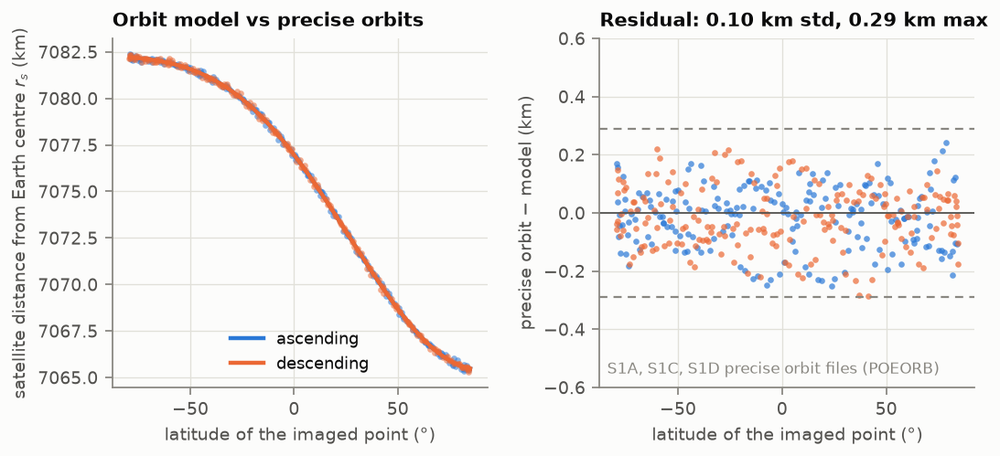

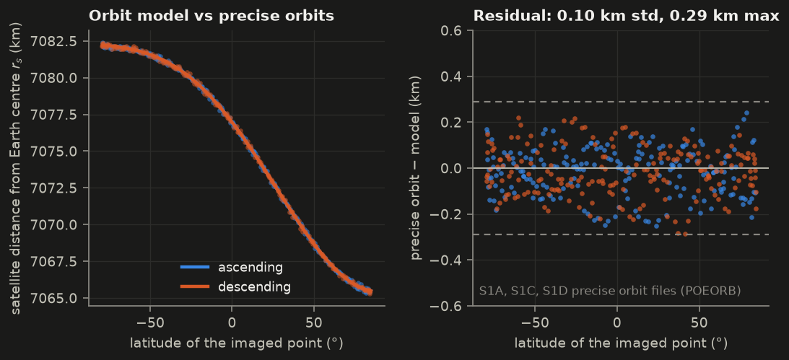

The model does not depend on the unit or on its slot: checked every month
from 2025 to 2026 on S1A, S1C and S1D, and every three days around the move
of S1C to the former S1A slot in June 2026 (S1C acquired nothing during the
move).  It does not hold during a commissioning phase, before the unit
reaches the reference orbit.

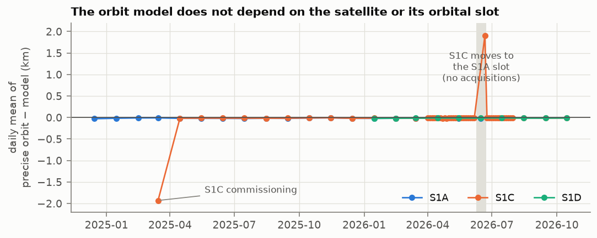

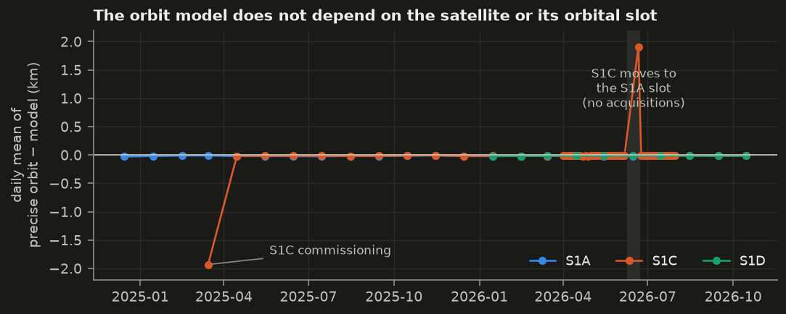

WV look-angle law
-----------------

ESA documents the centre off-nadir angle of the WV1 and WV2 beams at the
lowest and highest orbit altitudes.  The library starts from that
documented value and adds a correction that depends on the latitude of the
imagette.  The correction was **learned from the ESA L2 OCN products**: for
each of 62,588 imagettes of 1,205 S1C and S1D products (2025-2026, latitudes
-79.5° to +86°) the off-nadir angle that makes the library match the ESA
incidence was computed, and a polynomial of degree 5 was fitted to it.  The
correction mostly accounts for the flattening of the Earth, which the
documented values ignore.  It does not depend on the pass direction.

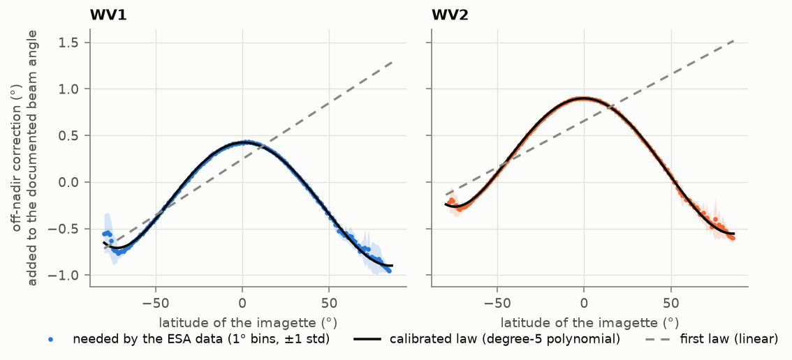

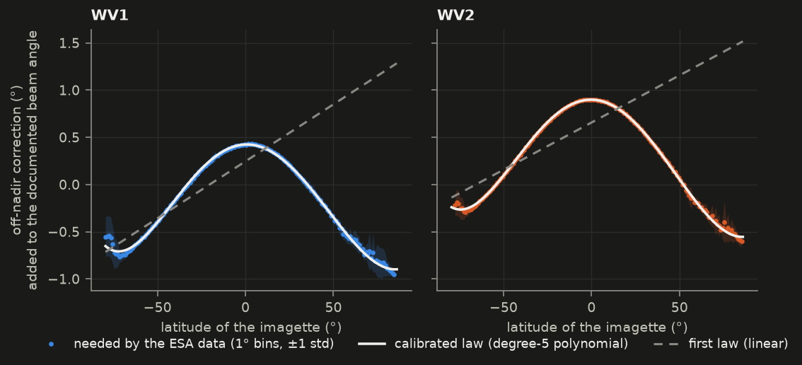

The first version of the law was a straight line fitted on mostly
southern-hemisphere products; it was up to 0.9° wrong at 45-50° N.

Calibration data
----------------

.. list-table::
   :header-rows: 1
   :widths: 22 38 22 18

   * - Model
     - Data
     - Size
     - Script
   * - Pass direction rule
     - CDSE daily catalogue, ``orbitDirection`` attribute, 2026-11-01..13
     - 66,243 IW / EW footprints
     - (tests)
   * - IW heading + uncertainty
     - ESA L2 IW OCN ``owiHeading``, 13 days, all units
     - 11,107 products
     - (embedded)
   * - IW / EW / SM off-nadir angles
     - ESA documentation (SentiWiki, S1 User Handbook)
     - --
     - --
   * - Orbit model
     - ESA precise orbit files ``AUX_POEORB``, S1A / S1C / S1D
     - 37,444 positions
     - ``scripts/calibrate_orbit_radius.py``
   * - WV look-angle law
     - ESA L2 WV OCN ``owiIncidenceAngle``, S1C 2025-2026 and S1D 2026
     - 62,588 imagettes
     - ``scripts/calibrate_wv_look_angle.py``

The calibrated numbers are written in the code (``heading.py``,
``angles.py``, ``orbit.py``, ``wv.py``) and only change with a new fit and a
new validation.

Accuracy
--------

Against the ESA L2 OCN products (model minus ESA, all grid cells; see
:doc:`certification` for the details):

.. list-table::
   :header-rows: 1
   :widths: 16 22 22 40

   * - Mode
     - Incidence RMSE
     - Heading RMSE
     - Data
   * - WV
     - 0.036°
     - 0.10°
     - 164 S1A / S1C / S1D products, 3 million cells; S1A not used in the fit
   * - IW, \|lat\| < 60°
     - 0.54° (median)
     - 0.50° (median)
     - 32 S1D products of 2026, plus the examples
   * - IW, \|lat\| > 60°
     - 2.5° (median)
     - 2.5° (median)
     - 9 S1D products of 2026
   * - EW, \|lat\| < 60°
     - 1.44° (median)
     - 0.50° (median)
     - 15 S1D products of 2026, plus the examples
   * - EW, \|lat\| > 60°
     - 2.1° (median)
     - 5.5° (median)
     - 4 S1D products of 2026
   * - SM
     - not validated
     - not validated
     - no L2 product exists

The IW / EW incidence error is dominated by the straight-line interpolation
of the off-nadir angle across the swath, whereas IW and EW are made of 3 and
5 sub-swaths with their own beams; the EW error is larger because its swath is
wider.  Beyond 60° of latitude the heading polynomials are less accurate and,
near the polar turn, the pass direction read from the footprint can be wrong
(5 of 46 IW products around 72° S, 8 of 29 EW products, mostly beyond 60° N,
in the 2026 sample); giving the catalogue ``orbitDirection`` instead would
avoid it.  The WV chain does not have these limits.

Limits
------

* WV products with fewer than 4 imagettes (end of a data-take) are rejected.
* WV footprints must keep the catalogue order of the imagettes (use
  ``Footprint`` / ``GeoFootprint``, not a re-ordered geometry).
* The orbit model is not valid during the commissioning of a unit.
* IW / EW footprints covering only part of the swath do not give the
  satellite distance and are rejected.
* The reference point must be inside the footprint.
* SM is specification-based only.

Reproduce
---------

Every number and figure of this documentation can be regenerated on the
Ifremer HPC (access to the ESA L2 OCN archive and the CDSE daily Parquets):

.. code-block:: bash

   python scripts/calibrate_orbit_radius.py --download <POEORB file names>
   python scripts/calibrate_wv_look_angle.py --rings rings.csv --workers 12 <SAFE dirs> --fit 5
   python scripts/validate_wv_ocn.py --out stats.csv --sample 3 <day dirs>
   python scripts/make_figures.py
